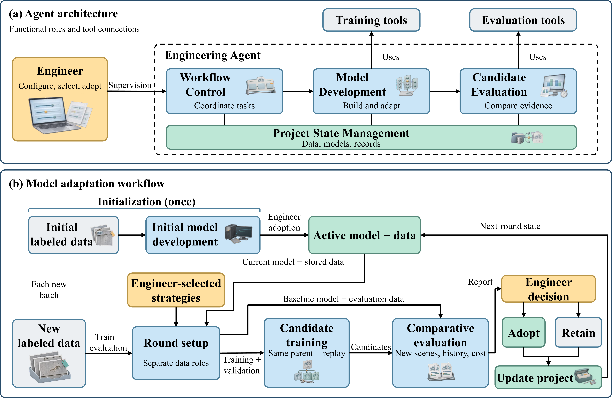
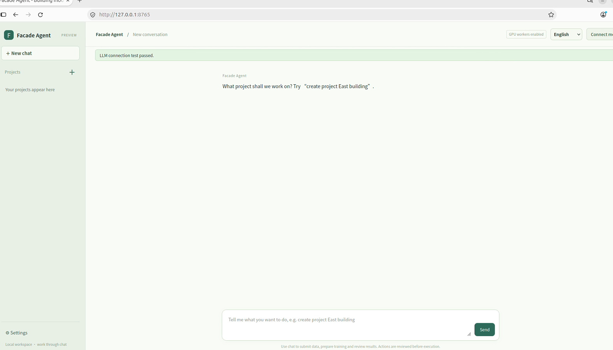
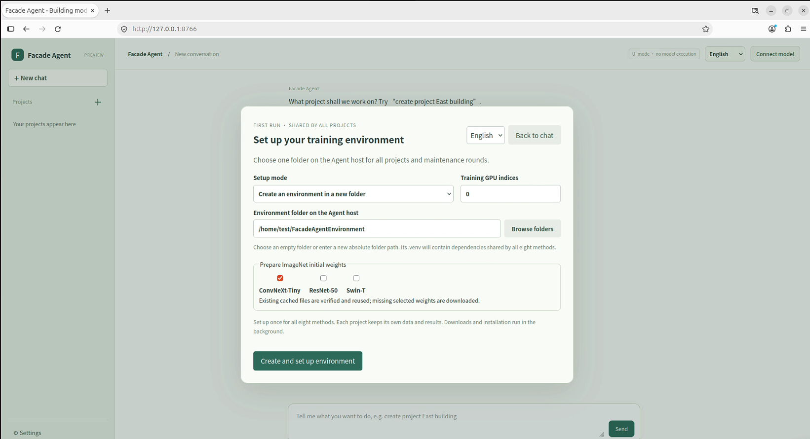
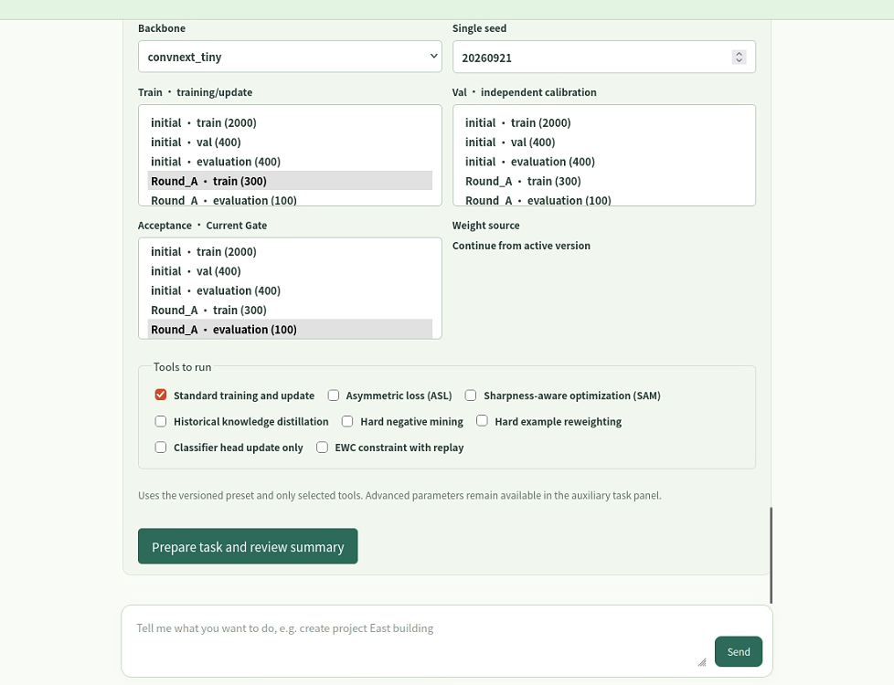
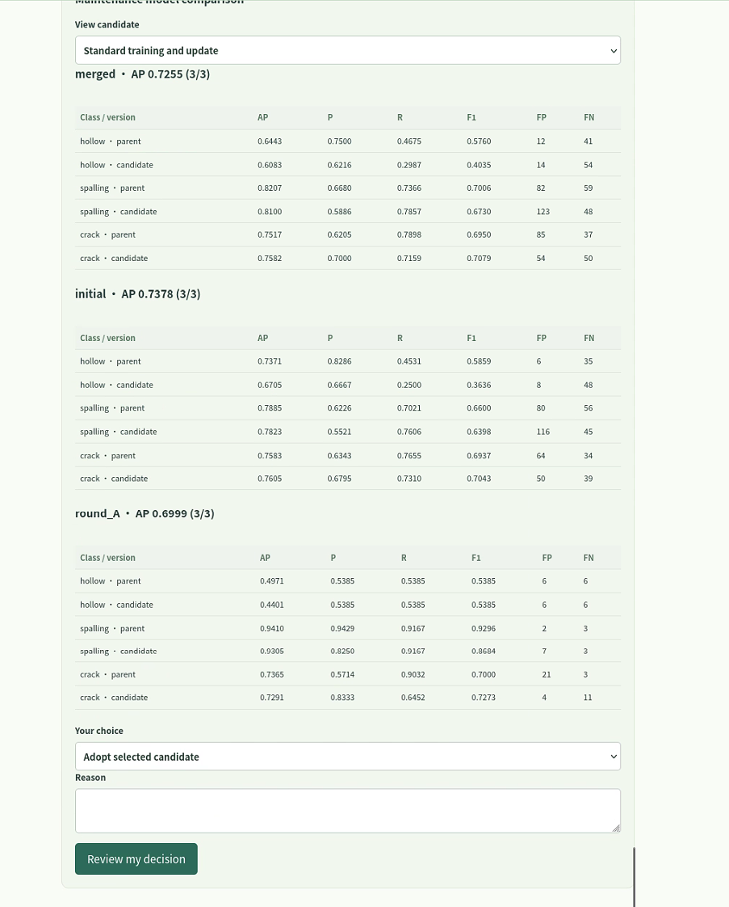

# building-facade-engineering-agent

[](https://huggingface.co/datasets/LotusRosa/BFD-ML-4K)

[中文说明](README_ZH.md) · [Companion dataset](https://huggingface.co/datasets/LotusRosa/BFD-ML-4K) · [Windows / Ubuntu checks](https://github.com/LotusRosa/building-facade-engineering-agent/actions/workflows/checks.yml)

A chat-driven, human-supervised agent for initial training, adaptation, evaluation, and version management of building-facade defect classifiers. Engineers supply labeled data, choose training strategies, and decide which model to adopt. The Agent coordinates the corresponding local tasks and preserves their configurations, results, and lineage.

The task is image-level multi-label screening of `hollow`, `spalling`, and `crack`; it does not require bounding boxes or segmentation masks. This is academic research software and does not replace professional inspection or engineering safety decisions. The [research-only license](LICENSE) governs use and redistribution.

## What the Agent provides

- A conversation-first browser workspace with project-specific parameters, data, results, saved tasks, and version records.
- Initial modeling from ImageNet-pretrained weights, followed by repeated adaptation from the actual active model.
- Explicit review of data roles and training settings before execution, and an engineer's reason and confirmation before adoption or retention.
- Independent evaluation on the current gate and accumulated historical acceptance sets.
- Three backbones and eight selectable adaptation strategies, without a mandatory failure-slice discovery stage.
- One shared training environment for multiple projects and one independent Worker per selected GPU.
- SQLite audit records, immutable task snapshots, checksums, calibrated thresholds, and model-parent relationships.
- Optional DeepSeek, OpenAI, or compatible LLM connections. The deterministic workflow remains available without an API key.

## Workflow and architecture

Four modules connect the workflow: **Workflow Control**, **Model Development**, **Candidate Evaluation**, and **Project State Management**.



Initial construction uses **Train + independent Val + initial acceptance S0**. Each later round supplies **new Train + independent Current Gate**; existing Val is reused and additional Val is optional. After completed evaluation and an explicit adopt/Hold decision, the new gate joins historical acceptance for subsequent rounds. There is no fixed limit on the number of rounds.

## Interface walkthrough

These newer screenshots were supplied during the actual Ubuntu validation session and replace the earlier Failure Slice interface illustrations. Original pixels and resolutions are retained. The recorded session uses the earlier **Facade Agent** branding and **Standard training and update** label; current labels are **building-facade-engineering-agent** and **Standard · Adaptation**. The screenshots are workflow records, rather than newly rerun experiments.

### Conversation-first project entry



Create a project in chat, then submit a batch folder and review the proposed data roles. Project tools remain in the left sidebar; language and LLM connection controls are in the top-right corner.

### Shared environment setup



Choose one environment folder on the Agent host. All projects and subsequent rounds reuse that environment; project data and results remain separately managed.

### Adaptation task configuration



The recorded Round-A task uses ConvNeXt-Tiny, seed `20260921`, 300 incoming training images, and a 100-image current gate. Its saved task also attaches the existing 2,000-image training history and 400-image Val pool.

### Parent and candidate evaluation



Inspect combined, historical-scene, new-scene, and class-level results before deciding. This screenshot shows the review form before confirmation; its selected option is not evidence of a completed adoption. [Screenshot sources and integrity](docs/assets/SCREENSHOT_SOURCES.json) record provenance.

## Requirements

- 64-bit Windows or Ubuntu, Python 3.11+, and a modern browser. Python 3.12 is the recorded reference.
- The UI uses the Python standard library and opens before GPU dependencies are installed.
- Training requires a compatible NVIDIA CUDA environment with native BF16 support. The recorded Ubuntu runs used RTX 4090 GPUs, one GPU per job.
- Node.js is optional for frontend development tests; it is not a runtime dependency.

The source package contains no model weights, CUDA binaries, training environment, runtime database, or dataset images. See [supported environments](SUPPORTED_ENVIRONMENTS.md) and [validation scope](docs/VALIDATION.md) for the distinction between model-free checks and GPU execution.

## Install and start the Agent

For a new computer, follow the [complete first-install guide](docs/FIRST_INSTALL.md), including host prerequisites, installation of the optional data-download tool, exact Windows/Ubuntu commands, data preparation and the first project. Keep the server terminal open while using the browser.

Clone or extract the source. An editable pip installation is not required to run it from this directory.

### Ubuntu

```bash
git clone https://github.com/LotusRosa/building-facade-engineering-agent.git
cd building-facade-engineering-agent
python3 scripts/check_release.py
python3 -m facade_next serve --state runtime --port 8765
```

Alternatively, run `bash run_linux.sh`. An existing interpreter can be selected with `FACADE_PYTHON=/path/to/environment/python bash run_linux.sh`.

### Windows PowerShell

```powershell
git clone https://github.com/LotusRosa/building-facade-engineering-agent.git
cd building-facade-engineering-agent
py -3.12 scripts/check_release.py
py -3.12 -m facade_next serve --state runtime --port 8765
```

Alternatively, double-click `start_ui.cmd`, or run `.\run_windows.ps1 -Python "D:\your_environment\python.exe"`.

Open **<http://127.0.0.1:8765>** on the Agent host. The service binds loopback. The internal command module remains `facade_next` to preserve existing command and task-record compatibility.

## Prepare the shared GPU runtime

The first-run browser wizard can create a training environment in a chosen folder or attach an existing one. Select the GPU indices and the ImageNet weights to prepare, then review the setup log. All projects share this host-wide environment.

The create-environment path currently installs the CUDA 12.8 PyTorch/TorchVision pair and checks CUDA/native BF16. It does not install the NVIDIA driver or automatically solve every GPU/driver combination. Existing compatible environments can be attached without replacing their packages. Interrupted downloads retain completed dependencies and verified cached files for a retry.

The `setup_linux_gpu.sh` and `setup_windows_gpu.ps1` helpers inspect the selected interpreter; requested installation and weight preparation occur through the browser wizard. A ready saved profile may enable its Workers on subsequent normal starts. For viewing only, use:

```bash
python -m facade_next serve --state runtime --port 8765 --ui-only
```

See [first-run setup](docs/FIRST_RUN_ENVIRONMENT.md). Initial training requires prepared ImageNet weights and never silently falls back to random initialization.

## Chat and project tools

Chat interprets requests, explains the next step, prepares task cards, and presents confirmations. The sidebar opens **Parameters**, **Data**, **Results**, **Saved tasks**, and **Versions** for the selected project. These views use the same project state and validation rules as chat.

For example, ask to create a project, identify an initial dataset folder, select a backbone, prepare a task, or start a new adaptation round. Configuration and import cards let the engineer inspect exact values before confirming. The LLM proposes supported actions; the program validates them and reports actual execution status.

Connect an LLM from the top-right **Connect model** control. Supply the provider, base URL, account-supported model ID, and key; saving settings does not itself verify connectivity. **Test connection** sends one request. Keys stay in service memory. See [LLM setup](docs/LLM_SETUP.md).

## First project: initial modeling

1. Create a project in chat and provide one already-split initial batch folder.
2. Review the mapping of Train, independent Val, and initial acceptance S0. Resolve label, class-support, identity, content, or group conflicts.
3. Choose a backbone and seed. **Core · Initial modeling** is the initial-stage entry, using ImageNet initialization and the initial training protocol.
4. Review the frozen data counts and task settings, then confirm execution. A Worker claims the queued job on an enabled GPU.
5. Inspect the initial model's independent evaluation. There is no parent model to compare in this first stage.
6. Enter a reason and confirm whether to adopt the model. Training completion does not automatically make a model active.

The resulting model contract binds the checkpoint, preprocessing, class order, thresholds, and source/data identities. An adopted checkpoint and its calibrated thresholds are carried forward together.

## Image folders and annotation guide

Prepare each data role separately. A typical initial batch is:

```text
initial/
  train/
    images/
    labels.csv
  val/
    images/
    labels.csv
  safety/
    images/
    labels.csv
```

Submit `initial` as one batch; the Agent recognizes and confirms the existing role folders. `labels.xlsx` can replace `labels.csv`. Complete labels skip repeat annotation; missing or partial labels remain available for review in chat. The Agent does not create a new random split.

### One image per row, one defect per column

| filename | hollow | spalling | crack | no_defect |
|---|---:|---:|---:|---:|
| image_001.jpg | 1 | 0 | 1 | 0 |
| image_002.jpg | 0 | 1 | 0 | 0 |
| image_003.jpg | 0 | 0 | 0 | 1 |
| image_004.jpg | | | | |

Labels are image-level and non-exclusive. `1` means present, `0` means confirmed absent, and blank means unknown. A partially known row is supported; unknown labels are masked rather than silently treated as negatives. If `no_defect=1`, all three defect labels must explicitly be zero; `no_defect` is not a fourth model class.

The current taxonomy is `hollow`, `spalling`, and `crack`. CSV is UTF-8; XLSX uses its first worksheet and rejects formulas. Native manifests can additionally provide `image_id,path,hollow,spalling,crack,scene,group`. Paths refer to images on the Agent host. Stable acquisition/building groups support cross-role separation; exact-content checks alone cannot identify all near-duplicates.

Templates are provided in [templates](templates). See [data preparation](docs/DATA_PREPARATION.md) for role rules, partial labels, and supported formats. Labels, role assignments, and source identities are frozen with submitted tasks; importing a table does not start training or adopt a model.

## Recurring adaptation round

### 1. Submit the next pre-split batch

Say **start a new maintenance round** and supply a folder containing `train` and `gate` (or the supported test/evaluation alias). New Val is optional. The existing Val, historical training pool, and historical acceptance are reused.

```text
round_A/
  train/
    images/
    labels.csv
  gate/
    images/
    labels.csv
```

### 2. Review the parent and select strategies

The task binds the actual active parent checkpoint and thresholds. Choose **Standard · Adaptation** or the required alternative strategies. Each candidate in a round shares the same parent and role assignment. Failure-slice discovery, clustering, and expert slice review are not prerequisites in the current workflow.

| Interface entry | Method ID | Purpose |
|---|---|---|
| Standard · Adaptation | `standard` | Standard full-network adaptation / FT |
| Asymmetric loss | `asl` | Asymmetric classification loss |
| Sharpness-aware minimization | `sam` | SAM optimization |
| Historical knowledge distillation | `distill` | Parent-teacher constraints on historical images / KD |
| Hard negative mining | `hnm` | Eligible incoming training negatives selected using the parent |
| Hard example reweighting | `hem` | Loss-weighted sampling of incoming training images / LWS |
| Classifier head update only | `head_only` | Update the classification head with a fixed encoder |
| EWC constraint with replay | `ewc_replay` | Parent-anchored EWC with historical replay |

Core is a stage-specific initial-modeling entry, not a ninth adaptation algorithm. Supported backbones are ResNet-50, ConvNeXt-Tiny, and Swin-T. Select methods for the task rather than automatically running the paper's full experimental matrix.

### 3. Confirm execution and inspect progress

Review the summary and confirm. The browser shows queue/Worker status and recorded training progress. Failed tasks retain their artifacts and logs. Training is not automatically retried, resized, or switched to another precision to conceal failure.

### 4. Review independent paired evaluation

The parent and candidate are evaluated on the same accumulated acceptance images: S0, previously completed gates, and the new current gate. Review combined, scene-specific, and class-specific AP, precision, recall, F1, false positives, false negatives, and available run-cost records. Training/calibration and independent evaluation retain separate roles.

### 5. Confirm the model decision

Choose the candidate to **adopt**, or **Hold** the existing parent, provide a reason, and confirm. Only a completed evaluation and recorded decision append the current gate to historical acceptance. Rollback to a previously adopted model is a separate recorded action. Selecting a dropdown option or finishing training alone does not adopt a model.

## Data separation across rounds

| Stage | Weight updates | Validation/calibration | Independent acceptance |
|---|---|---|---|
| Initial | Train0 | Val0 | S0 |
| A | TrainA + permitted training history | Existing Val; optional new ValA | S0 + GateA |
| B | TrainB + permitted training history | Accumulated Val; optional new ValB | S0 + GateA + GateB |

Val and acceptance images never enter training, mining, or Fisher estimation. Protected roles remain protected across subsequent and cancelled rounds. Gate accumulation does not turn evaluation data into replay data. Ordinary projects do not need the separate Final set used by the frozen research experiment.

## Companion BFD-ML-4K data

The [Hugging Face corpus](https://huggingface.co/datasets/LotusRosa/BFD-ML-4K) and this repository are linked through an explicit fixed-protocol manifest. The currently published dataset's original partitions differ from the current paper's allocation; renaming those directories is insufficient.

The supplied [protocol](protocols/bfd_ml_4k/protocol.json) pins the upstream revision, metadata hash, 4,000 image identities, labels, anonymous groups, and role assignments. After downloading the pinned corpus, prepare a new initial/A-round directory with:

```bash
python scripts/prepare_bfd_ml_4k.py --dataset-root /path/to/BFD-ML-4K --output /path/to/FacadeAgentData
```

This copies existing frozen assignments, verifies selected source/copied image checksums, writes importable label tables, and refuses an existing output folder. It performs no random splitting and does not modify the download. Final is excluded. See [download commands and exact role counts](docs/BFD_ML_4K.md) and the separate dataset license.

## Saved tasks, model versions, and screenshots

Open **Saved tasks** inside the original project to read completed task snapshots, parent/candidate evaluations, recorded costs, and historical model decisions. Missing records remain marked as not recorded. Existing completed tasks need not be retrained or adopted again for display.

The three saved-task panels can export `agent_task_configuration.png`, `agent_candidate_evaluation.png`, and `agent_version_record.png` at native 2600-pixel width. Final export acceptance is a target-server check. The documentation screenshots above are original session images, not substitutes for those paper-panel exports. See [saved-task instructions](docs/SERVER_SCREENSHOTS.md).

When upgrading, keep the original host's runtime, photos, and checkpoint paths. Existing `facade_next` tasks can be read using their original state directory. Earlier `facade_agent` databases and 768-crop model formats are not silently migrated. See [upgrade instructions](docs/UPGRADING.md).

## Multiple projects and the shared GPU queue

Projects keep separate datasets, conversations, configurations, and version histories. They reuse the host's selected training environment. Available GPU slots are shared by the queue, with at most one independent Worker per selected GPU; multiple selected GPUs can execute separate jobs concurrently. This replaces the earlier single-global-Worker restriction.

## Local files and privacy boundaries

Data paths identify files on the Agent host; entering a path is not a browser upload of all photos. The service stores SQLite records and job artifacts under the selected state directory. Pictures, checkpoints, training caches, and runtime databases are excluded from the published source.

When enabled, the selected LLM receives chat text and necessary task summaries. Photo bytes and model weights are not uploaded with chat. API keys stay in process memory and must not be committed to the repository. Confirmations and application validation apply to both LLM-assisted and deterministic operation.

## Common status messages

| Status | Meaning / next step |
|---|---|
| No project | Create or select a project in chat. |
| LLM not connected | Rule-based operation remains available; use Connect model if desired. |
| UI mode | The interface is running without starting saved GPU Workers. |
| Environment not ready | Create or attach the shared training environment and inspect its log. |
| Queued / running | A task is waiting for or using an enabled GPU slot. |
| Succeeded | Inspect the actual evaluation and record a separate model decision. |
| Failed / interrupted | Inspect retained logs and actual process status before recovery. |

## Verify a source checkout

```bash
python scripts/check_release.py
python -m unittest discover -s tests
```

Optional frontend checks use Node.js, for example `node tests/test_history_ui.js`. [GitHub Actions](https://github.com/LotusRosa/building-facade-engineering-agent/actions/workflows/checks.yml) runs required-file/hash checks, guarded standard-library tests, and frontend checks on Windows and Ubuntu. These checks do not execute models or certify every GPU/backbone/strategy combination. See [validation scope](docs/VALIDATION.md).

## Relationship to the manuscript

Associated paper: *Agent-Assisted Automation of Model Adaptation for UAV-Based Building Facade Inspection*. The fixed internal data roles and eight adaptation strategies correspond to the paper. **Initial-training precision still differs:** the manuscript specifies FP16 with gradient scaling, whereas the current interactive Worker uses BF16. The public quickstart is not a one-command reproduction of the complete multi-seed benchmark or external CUBIT-Det experiment. See the [correspondence and exact-reproduction limits](docs/MANUSCRIPT_CORRESPONDENCE.md).

## Technical references

- [Data-role contract](ACCUMULATING_GATE_PROTOCOL.md)
- [Supported environments](SUPPORTED_ENVIRONMENTS.md) and [GPU handoff](AGENT_COMPLETE_GPU_HANDOFF.md)
- [Data preparation](docs/DATA_PREPARATION.md), [first-run setup](docs/FIRST_RUN_ENVIRONMENT.md), and [LLM setup](docs/LLM_SETUP.md)
- [Dataset revision and protocol](docs/BFD_ML_4K.md)
- [Third-party notices](THIRD_PARTY_NOTICES.md)
- [Coverage of the previous README](docs/README_COVERAGE.md) and [published-file correspondence](docs/GITHUB_PARITY.md)

## Citation

Citation is mandatory for public research outputs using this software. Cite the authors, software name, year, exact version or commit, and canonical repository. Machine-readable metadata is in [CITATION.cff](CITATION.cff).

```text
Xia, Yu, and Chen, Ruoyu. (2026).
building-facade-engineering-agent (Version 3.0.0) [Computer software].
https://github.com/LotusRosa/building-facade-engineering-agent
```

## Authors

- **Yu Xia** — first author and repository maintainer.
- **Ruoyu Chen** — corresponding author (`chenruoyu@just.edu.cn`).

Copyright in the first-party software is held by Yu Xia and Ruoyu Chen.

## License

The **Building-Facade Engineering Agent Academic Research License 1.0** permits non-commercial academic or scientific research under its terms. Commercial use, redistribution, re-hosting, sublicensing, and offering the software as a service require prior written permission. Citation and attribution are mandatory.

This is a custom research-only, source-available license. Read the complete [LICENSE](LICENSE). Third-party software, pretrained weights, datasets, and LLM services retain their own independent terms; see [THIRD_PARTY_NOTICES.md](THIRD_PARTY_NOTICES.md).
