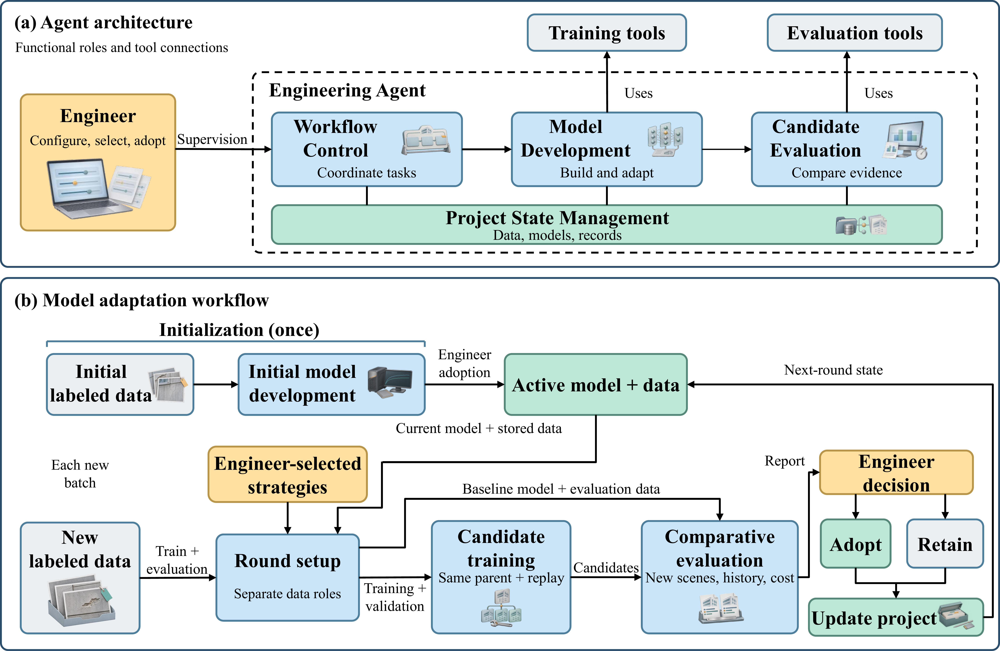

# building-facade-engineering-agent

[](https://huggingface.co/datasets/LotusRosa/BFD-ML-4K)

通过聊天完成建筑外立面图像级多标签模型的初始建模、后续适应训练、评估与版本管理。Windows 和 Ubuntu 使用同一套浏览器界面；项目保存在运行 Agent 的主机上。

[English](README.md) · [GitHub](https://github.com/LotusRosa/building-facade-engineering-agent) · [配套数据与固定划分](docs/BFD_ML_4K.md)

## 工作流程



## 启动

新电脑可按 [完整首次部署教程](docs/FIRST_INSTALL.md) 操作，含 Windows／Ubuntu 的前置工具、数据下载工具安装、固定数据准备及首个项目步骤。浏览器使用期间请保持服务终端开启。

界面需要 Python 3.11 或更高版本，无需预先安装 PyTorch。进入本目录执行：

```bash
python -m facade_next serve --state runtime --port 8765
```

打开 <http://127.0.0.1:8765>。Windows 可双击 `start_ui.cmd`，Ubuntu 可运行 `bash run_linux.sh`。浏览器首次打开时，可以选择主机上的一个文件夹配置共享训练环境；配置一次后，各项目与各轮任务共用该环境。

仅查看界面时使用：

```bash
python -m facade_next serve --state runtime --port 8765 --ui-only
```

## 聊天推进任务

1. 创建或选择项目，提供已经划分好的数据文件夹。初始建模需 Train、独立 Val 和初始验收集 S0；后续适应轮需新增 Train 和独立 Current Gate，新增 Val 可选，已有 Val 可复用。
2. 初始建模使用 **Core · Initial modeling**，从 ImageNet 预训练权重开始。后续使用 **Standard · Adaptation** 或按需选择其他更新策略，从实际生效版本继续。
3. 核对数据角色、模型、种子和参数后确认训练。聊天卡片显示真实任务状态与训练进度。
4. 查看保存的合并、逐场景和逐类 AP、F1 等评估结果，再填写理由，确认采用候选或保留原模型。训练完成不会自动采用模型。

左侧项目栏可查看参数、数据、结果、已保存任务及版本记录。界面语言和模型连接位于右上角。可接入 DeepSeek、OpenAI 或兼容接口；未配置 LLM 时可使用规则流程。API Key 仅存服务内存，不写入项目数据库。

## 已完成实验与截图

在原项目的“已保存任务”中，可以读取同一轮任务的冻结配置、已有候选评估及真实历史决策。无需重新训练或再次采纳。三个面板分别导出原生 2600 像素宽 PNG：

- `agent_task_configuration.png`
- `agent_candidate_evaluation.png`
- `agent_version_record.png`

缺失指标、成本或决策会显示未记录，不根据当前默认参数补写历史。服务器上的旧项目应继续使用其原有状态目录和数据路径，见 [保留项目与截图步骤](docs/SERVER_SCREENSHOTS_CN.md)。

## 数据、环境与训练策略

用户提供划分好的数据，Agent 不自动切分；Val 与验收数据不进入训练。照片、标注和模型权重均保存在主机，软件包不包含实验数据库或数据集图片。BFD-ML-4K 的固定清单及准备工具见 [数据配套说明](docs/BFD_ML_4K.md)。

支持 ResNet-50、ConvNeXt-Tiny、Swin-T。Core 为首轮入口，Standard 为后续标准适应入口；两者按阶段使用相应训练协议，其他策略包括 ASL、SAM、历史蒸馏、困难负样本挖掘、困难样本重加权、仅分类头更新和 EWC 回放。

训练要求受支持的 NVIDIA CUDA/BF16 环境。环境向导执行用户发起的依赖安装和所选 ImageNet 权重准备，显示下载、校验与错误信息；不安装显卡驱动。

- [数据格式与划分要求](docs/DATA_PREPARATION.md)
- [共享环境向导](docs/FIRST_RUN_ENVIRONMENT.md)
- [LLM 连接](docs/LLM_SETUP.md)
- [支持的运行环境](SUPPORTED_ENVIRONMENTS.md)
- [许可证](LICENSE) 与 [引用信息](CITATION.cff)

## 检查

```bash
python scripts/check_release.py
```

该命令检查必要文件和发布包哈希，不导入模型或执行训练。验证范围见 [验证记录](docs/VALIDATION.md)。内部 Python 模块名保持 `facade_next`，以兼容现有命令和项目记录。

## 与当前论文的对应关系

数据角色与八种适应策略已核对；仍有一项初始训练精度差异：论文为 FP16 加梯度缩放，当前交互 Worker 为 BF16。普通首轮／A 轮教程不等于整套多种子实验或外部 CUBIT-Det 实验的完整复现。详见 [论文对应与复现范围](docs/MANUSCRIPT_CORRESPONDENCE.md)。
